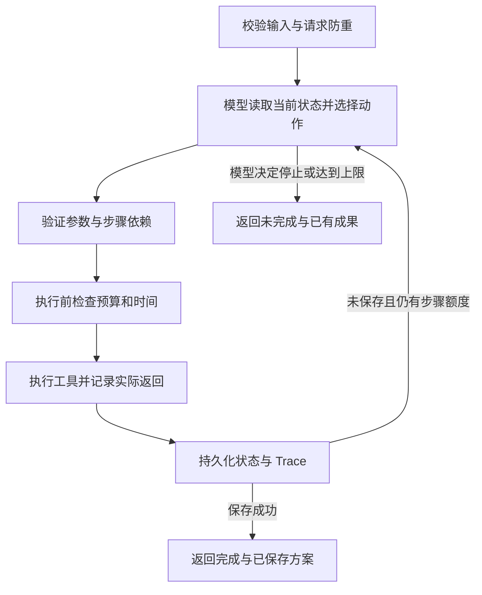

# 调用流程与技术取舍

## 结构

| 文件 | 职责 |
| --- | --- |
| `src/main.py` | CLI、配置与 JSON 输入输出 |
| `src/domain.py` | 输入校验、素材加载、共用费用公式 |
| `src/model.py` | 真实模型原生工具调用、脚本生成、独立离线 Mock |
| `src/prompts.py` | 工具定义、行为约束、生成要求 |
| `src/agent.py` | 模型动作循环、工具执行、约束检查、Trace |
| `src/storage.py` | SQLite、请求防重、逐步保存和执行互斥 |
| `src/evaluate.py` | 验收用例、实际输出、Trace 与评估索引 |

选择 Python 3.11+ 标准库和 SQLite，降低安装成本，方便独立检查费用与状态。Agent 调用循环原生实现，HTTP 接入使用 `urllib`，协议为兼容 Chat Completions 的原生工具调用。

## 模型决策循环

每轮将用户要求、当前预算/时间余额、检索结果、候选计划、成功脚本、上一步实际返回及近期执行记录送入模型。模型通过原生函数调用选择一个动作，附一句公开决策依据。程序执行并将结果更新到下一轮上下文。

允许动作包括四个业务工具，以及不计业务费用的 `finish` 控制动作。真实模式由模型选择下一工具；执行器负责校验约束、执行调用并保存状态。方案写入数据库后，程序根据持久化结果将任务标记为完成。

每轮从当前业务状态构造上下文，将前次工具结果传给模型。Trace 保留 response ID、tool call ID、调用参数、实际返回和简短动作依据。

## 四个工具的输入输出

| 工具 | 模型提供的参数 | 主要返回内容 |
| --- | --- | --- |
| `search_materials` | `query` | 排序后的素材与相关分 |
| `estimate_plan` | 全部脚本步骤的 `step_id`、`material_ids`、`brief` | 剩余费用/耗时、预计总额、是否可行和缺口 |
| `generate_script` | 已估算计划中的 `step_id` | 实际脚本标题、分镜、旁白、引用 ID |
| `save_plan` | 活动 `title`、`summary` | 数据库中的方案 ID 及完整成果 |

所有动作附带 `reason` 作为简短公开说明，返回共同包含 `status`、`data`、`error`、`charged`。工具执行状态与方案可行性分别记录：估算调用成功时，仍可以返回 `feasible=false`，供模型继续调整计划。

生成每条脚本时独立调用模型，产出标题、分镜、旁白和素材引用。程序自动校验结构完整性与引用范围，生成内容结合素材进行样例复核，完整文本保存在运行结果中。

## 预算和时间

估算调用先消耗自身的 `1`，然后计算尚未成功的生成步骤与必要保存步骤。生成前再次检查整个剩余计划，避免额外调用或失败重试使此前报价失效。

模型结束任务时，程序根据最新累计消耗重新核对当前计划的缺口，历史报价继续保留在 Trace 中。结束核算属于程序内部约束检查，不产生新的业务工具费用或耗时。

同一计划中已成功的步骤直接复用，原有消耗保留在累计总额中。执行前被参数、依赖或额度校验拦截的动作不计消耗；已启动的失败调用完整计费。时间按工具表顺序累加，费用按统一模拟费率计算。

## 状态与幂等

SQLite 中 `runs` 保存每个请求的当前状态，`plans` 以 `request_id` 为唯一键保存成果。每次工具结果和对应状态在事务内写入；保存成果与任务完成状态一同提交。OS 文件锁避免同一数据库被并发 CLI 重复执行，进程退出后锁自动释放。

无显式 ID 时，使用规范化请求的哈希作为 ID；同一请求再次执行直接返回已有结果。相同 ID 的输入或数据/模式发生变化时拒绝复用，避免错误套用旧结果。素材或规则替换后测试应使用新 ID 或新的数据库。

`--resume` 显式恢复任务，后续计划原样保留已成功的脚本。累计决策次数默认上限为 16，包含错误参数和被拒绝的调用；达到上限返回 `STEP_LIMIT`。

## 故障注入与恢复范围

故障配置通过独立 `--faults` 文件在工具执行层生效。模型读取工具实际返回的错误后决定下一步。离线 Mock 使用独立策略类，输出标记为 `offline_mock`。

运行器采用单机 CLI 和步骤级事务。工具错误、显式停止和保存失败均会留下可恢复状态。强制终止进程时，恢复以最近一次已提交的状态为起点；若外部模型请求已完成而本地事务尚未提交，当前步骤可能再次调用。

协议参考：[DeepSeek Tool Calls](https://api-docs.deepseek.com/guides/tool_calls/)、[Chat Completions](https://api-docs.deepseek.com/api/create-chat-completion/)、[OpenAI Function calling](https://developers.openai.com/api/docs/guides/function-calling)。
