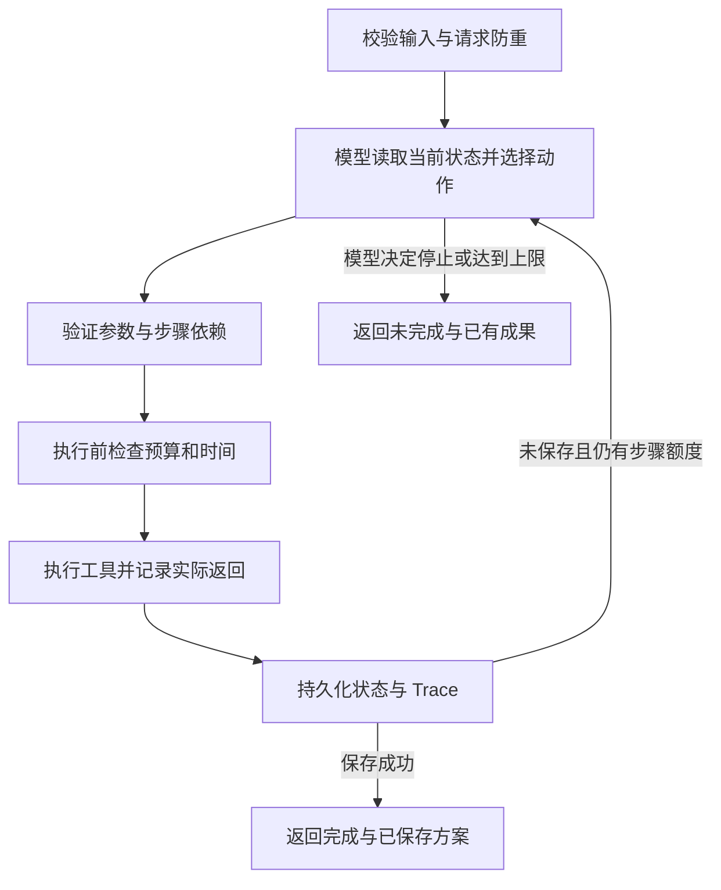

# 调用流程与技术取舍

## 结构

| 文件 | 职责 |
| --- | --- |
| `src/main.py` | CLI、配置与 JSON 输入输出 |
| `src/domain.py` | 输入校验、素材加载、共用费用公式 |
| `src/model.py` | 真实模型原生工具调用、脚本生成、独立离线 Mock |
| `src/prompts.py` | 工具定义、行为约束、生成要求 |
| `src/agent.py` | 模型动作循环、工具执行、约束检查、Trace |
| `src/storage.py` | SQLite、请求防重、逐步保存和执行互斥 |
| `src/evaluate.py` | 验收用例、实际输出、Trace 与评估索引 |

选择 Python 3.11+ 标准库和 SQLite，安装成本低，费用与状态容易独立检查。不使用 Agent 框架；HTTP 接入通过 `urllib`，协议为兼容 Chat Completions 的原生工具调用。

## 模型决策循环

每轮将用户要求、当前预算/时间余额、检索结果、候选计划、成功脚本、上一步实际返回及近期执行记录送入模型。模型通过原生函数调用选择一个动作，附一句公开决策依据。程序执行并将结果更新到下一轮上下文。

允许动作包括四个业务工具，以及不计业务费用的 `finish` 控制动作。真实模式没有 Python 分支替模型选择下一工具；固定代码只验证约束、执行模型选中的工具并保存状态。保存成功后由程序依据数据库结果结束任务，防止模型虚报成功。

每次请求使用当前完整业务状态作为上下文，无需依赖服务端会话。前次实际工具结果以结构化状态传回模型；记录保留模型返回的 response ID、tool call ID 和简短依据，不记录内部思维过程。

## 四个工具的输入输出

| 工具 | 模型提供的参数 | 主要返回内容 |
| --- | --- | --- |
| `search_materials` | `query` | 排序后的素材与相关分 |
| `estimate_plan` | 全部脚本步骤的 `step_id`、`material_ids`、`brief` | 剩余费用/耗时、预计总额、是否可行和缺口 |
| `generate_script` | 已估算计划中的 `step_id` | 实际脚本标题、分镜、旁白、引用 ID |
| `save_plan` | 活动 `title`、`summary` | 数据库中的方案 ID 及完整成果 |

所有动作还附 `reason`，仅用于简短公开说明。返回共同包含 `status`、`data`、`error`、`charged`。估算工具可以执行成功但返回 `feasible=false`，不把“方案不可行”混成“工具执行失败”。

生成每条脚本时会独立调用模型。只接受非空标题、分镜、旁白和合法素材引用；生成文本保存在结果中。自动验证引用 ID 存在且来自提供的素材，不声称已经完成任意自然语言事实的自动核验。

## 预算和时间

估算调用先消耗自身的 `1`，然后计算尚未成功的生成步骤与必要保存步骤。生成前再次检查整个剩余计划，避免额外调用或失败重试使此前报价失效。

同一计划的成功步骤不再估价或执行，但原有消耗仍属于累计总额。执行前的参数、依赖、额度拒绝不计消耗；已开始执行的失败调用完整计费。所有模拟时间顺序累加，不等待真实时间，也不统计模型 API 账单。

## 状态与幂等

SQLite 中 `runs` 保存每个请求的当前状态，`plans` 以 `request_id` 为唯一键保存成果。每次工具结果和对应状态在事务内写入；保存成果与任务完成状态一同提交。OS 文件锁避免同一数据库被并发 CLI 重复执行，进程退出后锁自动释放。

无显式 ID 时，使用规范化请求的哈希作为 ID；同一请求再次执行直接返回已有结果。相同 ID 的输入或数据/模式发生变化时拒绝复用，避免错误套用旧结果。素材或规则替换后测试应使用新 ID 或新的数据库。

`--resume` 显式恢复未完成任务。已成功脚本不允许在后续计划中删除或修改。累计决策次数默认上限 16，包含错误参数和被拒绝的调用，防止免费估算或无效动作无限循环。

## 故障注入与边界

故障配置通过独立 `--faults` 文件传入工具执行层，不作为用户业务输入，也不提前告诉模型在哪一步会失败。工具实际返回注入的错误后，模型才决定下一步。离线 Mock 的动作策略位于独立类中，输出明确标记 `offline_mock`。

这是 CLI 单机考核实现。进程在外部模型请求已经完成、但当前步骤事务尚未提交时硬退出，外部调用无法原子回滚；恢复可能重新调用该未提交步骤。正常工具错误、显式停止和保存失败均会留下可恢复状态。未建设生产级分布式运行时。

协议参考：[DeepSeek Tool Calls](https://api-docs.deepseek.com/guides/tool_calls/)、[Chat Completions](https://api-docs.deepseek.com/api/create-chat-completion/)、[OpenAI Function calling](https://developers.openai.com/api/docs/guides/function-calling)。
